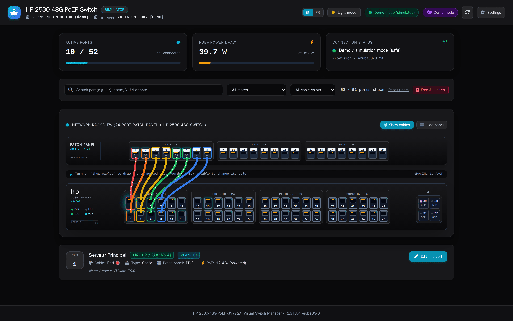
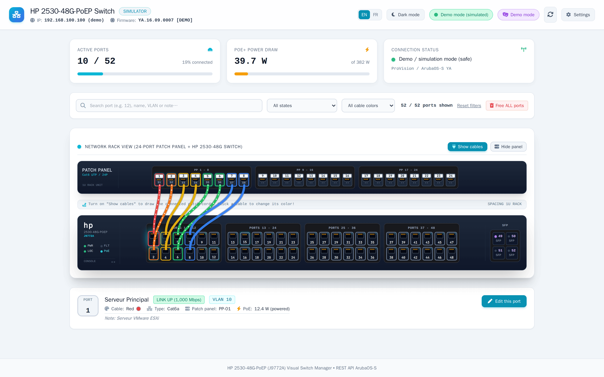
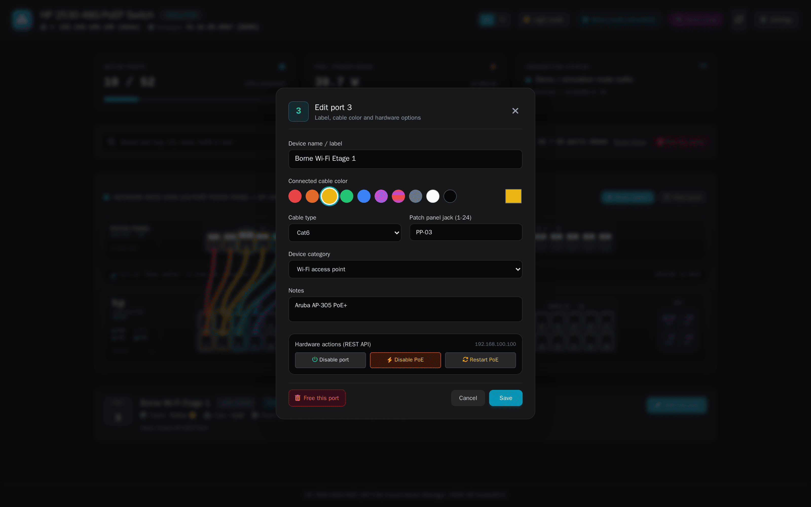

# Aruba Switch Control



A web interface to see and control an **HP / Aruba 2530-48G-PoEP (J9772A)** switch running ArubaOS-S: live state of all 52 ports, PoE+ power draw, a rack view with a 24-port patch panel and colored patch cords, and notes for each port.

FastAPI back end that queries the switch REST API (v4), plain HTML/JS front end with no build step, port metadata stored in SQLite. The interface is available in English and French.

## Features

- Live port state (link, speed, VLAN, PoE), refreshed every 5 s
- Rack view: patch panel + switch, with cables drawn between them; click a cable to change its color
- Per-port sheet: name, cable color and type, patch panel jack, device category, notes
- Hardware actions: enable / disable a port, turn its PoE off or power-cycle it
- Search, and filters by state or cable color
- Multi-select with Ctrl+click for bulk actions
- Demo mode without a switch (`DEMO_MODE=true`), with its own database
- Light / dark theme
- English / French interface, switchable from the header; the first visit follows the browser language

| Light theme | Port editor |
|---|---|
|  |  |

## Installation (Docker)

```bash
git clone https://github.com/guim31/aruba-switch-control.git
cd aruba-switch-control
cp config.example.json config.json   # then set the switch IP, account and password
touch switch_metadata.db             # otherwise Docker creates a directory instead of the file
docker compose up -d --build
```

The interface is served on `http://<host>:8085`. The configuration can also be changed from the **Settings** button in the interface.

Without Docker: `pip install -r requirements.txt`, then `python run.py`.

To try it without a switch: `DEMO_MODE=true python run.py`.

### Switch side

Reading goes through the REST API (`rest-interface`). Port and PoE actions go through telnet (port 23), which must therefore be enabled. They need the password of the **manager** account.

## Deploying to a NAS

`deploy.sh` copies the folder to a remote host with `rsync`, then offers to rebuild the container. The target is set in `.deploy.env` (copy `.deploy.env.example`). `config.json` and the database are never overwritten.

## Development

The interface texts live in `public/js/i18n.js` (one dictionary per language). Static HTML uses `data-i18n`, `data-i18n-placeholder`, `data-i18n-title` and `data-i18n-aria-label` attributes; JavaScript calls `t(key, vars)`.

Two Playwright scripts run against the app in demo mode (`DEMO_MODE=true python run.py`). They need the `playwright` npm package and a Chromium it can launch.

- `node scripts/check-i18n.mjs [url]` walks through the page, modals, filters, dialogs and settings in English and checks that no French text remains, then does a lighter reverse check in French. It also fails on any browser console error.
- `node scripts/screenshots.mjs [url]` regenerates the images in `docs/screenshots/` (compressed with `pngquant` when installed).

## Security

- `config.json` holds the switch password in clear text: it is excluded from the repository, do not commit it.
- **The application has no authentication** and can cut PoE power on the ports. Do not expose it to the Internet; keep it on the local network or behind an authenticated reverse proxy.

## License

MIT
